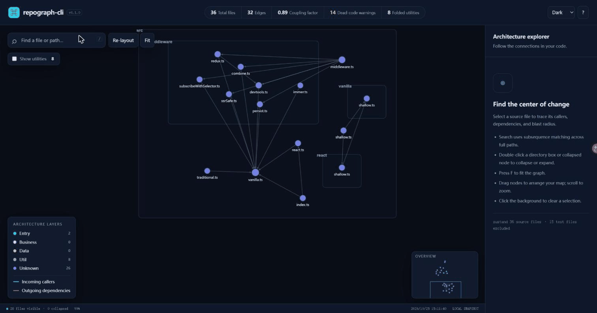

# RepoGraph

Turn any codebase into an interactive architecture map in 2 seconds. Zero server, full privacy, built for Claude & Claude Code.



[](https://www.npmjs.com/package/repograph-cli) [](LICENSE) [](https://nodejs.org/) 

👉 **[Try the interactive live demo](https://karry1123.github.io/repograph/)** (zustand's architecture, generated with one command)

Find the files that matter before changing the code. RepoGraph scans local imports, groups source files by directory and likely architectural layer, and writes an interactive HTML map. Directory clustering and utility folding help keep shared helpers from turning the view into a spiderweb. Three MCP tools let Claude inspect architecture and trace the impact of a proposed change.

“2 seconds” describes the quickstart experience, not a measured performance guarantee. Scan time and HTML size depend on the repository; a small map can be ~40 KB. No account, server, or configuration file is required.

## Quickstart

```sh
npx repograph-cli .
```

Open the printed `file:///.../repograph.html` link. Click a file to see its incoming callers in cyan and outgoing dependencies in red. Double-click directory boxes to collapse or expand them. Press `f` to fit the graph to the viewport. Search matches subsequences in full file paths; the minimap lets you jump around large graphs.

Node.js 18 or newer is required. Scanning stays on your machine. The HTML embeds your file paths and graph data, so treat it as repository information when sharing. Opening the interactive map downloads pinned Cytoscape/layout scripts from public CDNs; no source or graph data is sent by RepoGraph. The CDN scripts must be reachable on first opening. SVG, JSON, and Mermaid exports need no browser CDN scripts.

## CLI reference

```text
repograph [path] [options]
repograph mcp

Options:
  -o, --output <file>       Write to a file
  --theme <theme>           dark | light | matrix (default: dark)
  --max-depth <n>           Maximum directory nesting (default: 6)
  --no-collapse-utils      Show utility candidates immediately
  --format <format>        html | json | mermaid | svg (default: html)
  -V, --version            Show version
  -h, --help               Show help
```

The path defaults to `.`. HTML defaults to `./repograph.html` in your current working directory and prints its absolute file URL after writing. Other formats print to stdout unless `--output` is supplied. Output directories are created automatically. `--max-depth 0` scans only root files.

```sh
npx repograph-cli ./my-app --output ./architecture.html --theme matrix
npx repograph-cli . --format json > graph.json
npx repograph-cli . --format mermaid --output architecture.mmd
npx repograph-cli . --format svg --output architecture.svg
npx repograph-cli . --max-depth 10 --no-collapse-utils
```

The static SVG arranges files in entry → business → unknown → data → util columns. Mermaid exports preserve nested directory subgraphs. Both include utility candidates; HTML initially hides folded utilities and their edges.

## Use with Claude

### Install from the MCP Registry

Registry metadata is prepared under the name `io.github.Karry1123/repograph`. After publication to the [official MCP Registry](https://registry.modelcontextprotocol.io), look up that name in a registry-compatible client; the manual Claude setup below also works.

### Claude Desktop

Add this entry to `claude_desktop_config.json`, merging it with existing servers:

```json
{
  "mcpServers": {
    "repograph": {
      "command": "npx",
      "args": ["-y", "repograph-cli", "mcp"]
    }
  }
}
```

Restart Claude Desktop, then ask: “Scan my repository at `/absolute/path/to/project` and show the impact of changing `src/core/graph.ts`.” Use an absolute repository path; the MCP server may start with a different working directory. Windows paths work too, for example `F:\\RepoGraph` in JSON.

### Claude Code

```sh
claude mcp add repograph -- npx -y repograph-cli mcp
```

Ask Claude to generate an architecture map before a refactor, or find all transitive callers of a module before editing it. MCP mode uses stdio for the protocol and writes errors only to stderr.

### Tools

| Tool | Arguments | Result |
| --- | --- | --- |
| `scan_repository_graph` | `path` (required string), `maxDepth` (integer, default `6`), `collapseUtils` (boolean, default `true`) | ArchitectureGraph JSON with nodes, edges, nested clusters, and metrics |
| `generate_architecture_html` | `path` (required string), `outputPath` (default `"./repograph.html"`), `theme` (`dark`, `light`, or `matrix`, default `dark`) | `{ success: true, filePath, nodeCount }` |
| `query_impact_path` | `path` (required string), `changedFile` (required relative file ID or absolute path) | Normalized changed file, direct dependents, transitive dependents with BFS depth, affected clusters, and blast radius |

For HTML generation, a relative `outputPath` is resolved against the repository path. An absolute output path is used directly. The tools use a utility fan-in threshold of 15. Missing changed files return an error with the closest matching IDs. `transitiveDependents` includes direct callers at depth 1; `blastRadius` counts unique affected files and excludes the changed file itself.

## How the map works

### Imports become edges

Each source file becomes a node with a forward-slash relative ID. Local imports become directed edges from importer to dependency. JavaScript and TypeScript use Babel, with a regex fallback for unsupported syntax. Repeated references of the same type are combined with an edge weight. External packages are dropped. Class inheritance through an imported binding gets an `inheritance` edge; `import()` gets a `dynamic` edge.

RepoGraph tries source extensions, directory index files, NodeNext `.js` → `.ts` equivalents, and a heuristic `@/` → `src/` alias. It does not execute code or load project-specific compiler plugins. Computed imports and custom aliases can be missed.

### Layers give the graph meaning

| Layer | File or directory clues | Colour |
| --- | --- | --- |
| Entry | controller, route, router, handler, api, endpoint, cli, app, server, main; root index | Cyan |
| Business | service, usecase, core, domain, logic, manager | Magenta |
| Data | repo, repository, model, schema, entity, store, db, dao, migration | Amber |
| Util | util, utils, helpers, common, shared, lib, constants, types, config; high fan-in | Slate |
| Unknown | Everything else | Indigo |

Classification checks entry, business, data, then utility clues. It is an explainable filename heuristic, not a semantic judgement about your design. Clusters reflect the first two directory levels and retain nested parents.

### Utility folding reduces noise

Files with more than 12 incoming callers and at most two outgoing dependencies, or utility-like names, are folding candidates. CLI/API default to 12; MCP defaults to 15. Folded nodes and their edges stay in the graph data and impact analysis but disappear from the initial HTML view. “Show utilities” reveals them. Degree counts use unique neighboring files, not repeated imports.

### Blast radius follows callers

Impact analysis performs a breadth-first search over reverse edges. It handles cycles, visits each file once, and records the shortest caller depth. The inspector lists direct callers and dependencies; the highlight traces both full transitive chains. If a cycle belongs to both chains, the dependency highlight takes precedence.

Dead-code warnings count files with no incoming local edges that do not look like entry points. Treat these as review hints: frameworks, reflection, external consumers, and dynamic loading can all create valid files with no static callers. Coupling factor is average unique out-degree; density is edges divided by `n * (n - 1)` (zero for fewer than two files). LOC counts nonblank source lines, including comments.

## Supported languages and scan rules

| Language | Resolution |
| --- | --- |
| JavaScript / TypeScript | ESM imports/re-exports, `require()`, dynamic imports, imported superclass bindings; JS/JSX/MJS/CJS/TS/TSX/MTS/CTS |
| Python | `import a.b`, absolute and relative `from` imports, `.py` modules and `__init__.py` packages |
| Go | Single imports and import blocks; paths under the root `go.mod` module resolve to every scanned `.go` file in the target directory |
| Rust | `mod x;` resolves to `x.rs` or `x/mod.rs`; `use crate::...` resolves modules under `src/` |

Root and nested `.gitignore` rules are respected. RepoGraph skips dependency, build, cache, and editor directories, including `node_modules`, `.git`, `dist`, `build`, `out`, `coverage`, `__pycache__`, `.venv`, `venv`, `.next`, `.nuxt`, `target`, `vendor`, `.idea`, `.vscode`, and `.cache`. Symlinks are skipped to prevent cycles. Files larger than 1.5 MB and `*.min.js` are excluded. Test/spec files are excluded from the main graph, with their count retained as `metrics.excludedTestFiles`.

Python, Go, and Rust resolution is intentionally static and heuristic: workspace manifests, build tags, Python import hooks, Rust macros, and non-root Go modules are not evaluated. Only files included in the scan can become nodes or targets.

## Where it fits

This table describes the tools' focus rather than a feature-completeness or performance benchmark. Check each project's current documentation for its full capabilities.

| | RepoGraph | Madge | CodeSee | Gitingest |
| --- | --- | --- | --- | --- |
| Primary output | Local interactive HTML architecture map | Module dependency graphs | Code exploration and mapping platform | Repository text context |
| Workflow | CLI + three MCP tools | Dependency analysis CLI/API | Platform workflow | Ingest code for LLM context |
| Main emphasis | Layers, utility folding, caller impact | Module relationships and cycles | Collaborative code understanding | Shareable code context |
| RepoGraph's approach | No server; embedded graph snapshot | Complementary dependency tooling | Different platform model | Complementary text-first tooling |

## Programmatic use

```ts
import { analyzeRepository } from 'repograph-cli/dist/src/api.js';
import { impactPath } from 'repograph-cli/dist/src/core/graph.js';
import { renderToHtml } from 'repograph-cli/dist/src/renderer/htmlTemplate.js';

const graph = await analyzeRepository('.', {
  maxDepth: 6,
  collapseUtils: true,
  utilThreshold: 12,
});
const impact = impactPath(graph, 'src/api.ts');
const html = renderToHtml(graph, { theme: 'dark' });
```

`createServer()` and `startMcpServer()` are exported from `dist/src/index.js`; importing the module does not start a transport. The graph data model lives in `src/types.ts` and ships with generated TypeScript declarations.

## Contributing

```sh
npm install
npm run build
node dist/bin/cli.js . --output demo/self.html
node dist/bin/cli.js . --format json
node dist/bin/cli.js . --format mermaid
```

During development, use `npm run dev -- .`. On Windows PowerShell installations that block `npm.ps1`, use `npm.cmd`. Keep path IDs portable, avoid executing scanned code, and test resolution changes against a small repository containing the relevant imports. Include reproduction steps and the expected edges in bug reports or contributions.

## License

MIT © 2026 Karry. See [LICENSE](LICENSE).

## Roadmap · star to vote

- [x] TypeScript/JavaScript
- [x] Python
- [x] Go
- [x] Rust
- [ ] Java/Kotlin (unlocks at 200 ⭐)
- [ ] C# (300 ⭐)
- [ ] PHP/Ruby (500 ⭐)
- [ ] Monorepo workspace + tsconfig paths alias resolution (200 ⭐)
- [ ] VS Code extension (1000 ⭐)

Star to vote, open a [Language Support Request issue](https://github.com/Karry1123/repograph/issues/new?template=language_support_request.yml), and share the imports and project layout you need supported. These thresholds guide priorities rather than promise delivery dates.
